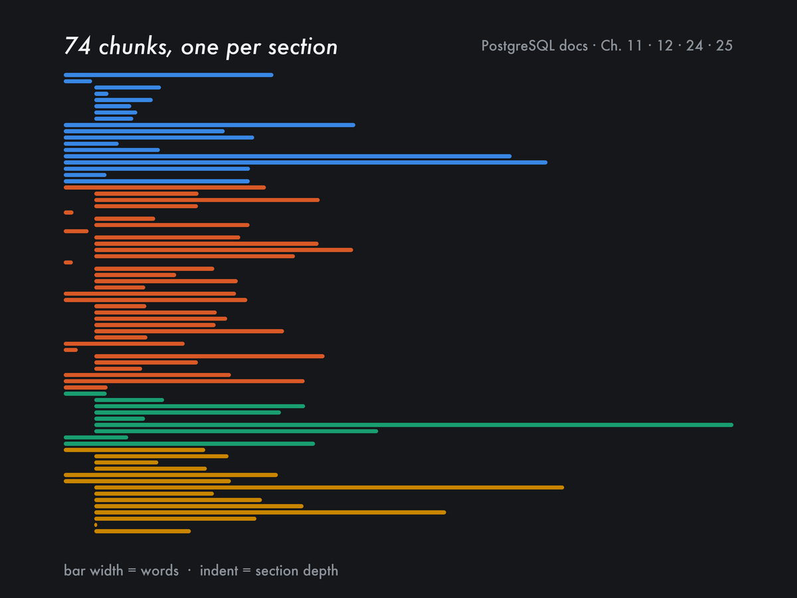

# PostgreSQL Documentation RAG

A retrieval-augmented generation system over the official PostgreSQL documentation, built to test one idea: **that the structure of the source HTML, not the embedding model, is what decides whether retrieval works.**



It indexes four chapters — **Indexes (Ch. 11)**, **Full Text Search (Ch. 12)**, **Routine Database Maintenance (Ch. 24)** and **Backup and Restore (Ch. 25)** — and answers questions about them with an exact citation to the section the answer came from, or says it does not know.

| | |
|---|---|
| Documentation version | PostgreSQL 18 (`/docs/current/`) |
| Downloaded | 2026-08-07 |
| HTML pages fetched | 29 physical pages, from 74 table-of-contents entries |
| Chunks indexed | 74 — one per section or subsection |
| Corpus size | 37,708 words |
| Embeddings | `all-MiniLM-L6-v2`, run locally |
| Vector store | ChromaDB, local and persistent |

---

## Quick start

```bash
pip install -r requirements.txt

python3 scraper.py      # fetch and parse the four chapters into data/raw_docs.json
python3 ingest.py       # build the ChromaDB index (74 chunks)

python3 rag.py "What index type should I use for equality comparisons?"
python3 evaluate.py --no-generate    # 22-question eval, no API key needed
```

`data/raw_docs.json` is committed, so you can skip `scraper.py` and go straight to `ingest.py` if you just want to query the corpus as it was on the download date. Re-running the scraper re-fetches the live documentation, which may have changed since.

**Generation is optional.** The system checks for two providers in order:

1. `GEMINI_API_KEY` → `gemini-flash-lite-latest` (free tier, no billing required)
2. `ANTHROPIC_API_KEY` → `claude-haiku-4-5`

With neither key set, it runs in retrieval-only mode: it returns the most relevant section with full source citations. That still answers the question and still cites the exact source — it just doesn't write prose around it.

---

## Project structure

```
postgres-docs-rag/
├── scraper.py        # fetches and parses 4 chapters into data/raw_docs.json
├── ingest.py         # flattens raw_docs.json into chunks and indexes to ChromaDB
├── rag.py            # CLI: query → retrieve → (optionally) generate → cite
├── evaluate.py       # runs eval_set.json and prints metrics
├── eval_set.json     # 22 questions with expected sources and per-question metrics
├── data/
│   └── raw_docs.json # the parsed documentation tree (committed)
├── cache/            # raw HTML cache, created by scraper.py
└── chroma_db/        # the vector index, created by ingest.py
```

---

## Design decisions

### 1. Scraping: a custom parser, not a generic one

`requests` + `beautifulsoup4`/`lxml`, fetching each physical HTML page once, caching it to disk, and parsing it into structured Markdown.

**Why not a generic scraper:** everything that makes this documentation worth querying is *structure*. A scraper that strips tags and returns plain text throws away exactly the content a reader needs — the operator table in 11.2.1, the `CREATE INDEX ... USING HASH` syntax in 11.2, the caution box about transaction ID wraparound. So the parser keeps it:

- `<pre class="programlisting">` becomes a fenced Markdown code block
- `<table>` becomes a Markdown table, not flattened prose
- `<div class="note/tip/caution/warning/important">` becomes a labelled blockquote
- cross-chapter links are reduced to their text, so no out-of-scope content leaks in

**Discarded:** `playwright`/`puppeteer` — these pages are server-rendered, no JavaScript involved. Pre-built scrapers (firecrawl, jina) — they hand back Markdown without keeping the raw HTML, which makes it impossible to inspect and correct the class-to-Markdown mapping, and that mapping is the whole job.

**The structural wrinkle that cost me the most time.** PostgreSQL's docs are generated by DocBook, which wraps every section like this:

```html
<div class="sect2" id="INDEXES-TYPES-BTREE">
  <div class="titlepage"><div><div>
    <h3 class="title">11.2.1. B-Tree</h3>
  </div></div></div>
  <p>…the actual content…</p>
</div>
```

My first version found the heading element and walked up to its parent to get the section container. That parent is an anonymous `titlepage` wrapper — three nested anonymous `div`s that contain the heading and nothing else. The scraper ran without error and produced chunks that were empty or near-empty. Nothing in the pipeline complained: ingest indexed them, retrieval returned them, and the answers were just quietly bad.

The fix is in [`slice_page()`](scraper.py): find the `sect1`/`sect2`/`sect3` container by class or by anchor id, then walk its children and skip two things — the `titlepage` wrapper, and any nested `sectN` div, since those are separate chunks of their own.

It's worth stating plainly why this matters: an embedding model cannot rescue a chunk that has no content in it. This failure happened before a single vector was computed.

### 2. Chunking: the table of contents defines the boundaries

Each section or subsection in the chapter TOC becomes exactly one chunk. 74 chunks for four chapters.

**Why:** the authors of this documentation already divided it into meaningful units. "11.2.1 B-Tree" and "24.1.2 Recovering Disk Space" are the granularity a reader actually asks questions at. Splitting by a fixed token count cuts a code block in half, separates a table from the paragraph that explains it, or glues the end of one topic to the start of an unrelated one.

For documentation with real section structure — technical manuals, API references, legal documents — this generalises. For prose without headings it does not, and a fixed-size splitter with overlap is the better default there.

**The trade-off, measured.** Chunk sizes are uneven, because sections are uneven:

| | words |
|---|---|
| Shortest chunk (25.3.7, "Tips and Examples") | 9 |
| Median chunk | 465 |
| Longest chunk (24.1.5, "Preventing Transaction ID Wraparound Failures") | 2,242 |
| Chunks over 800 words | 11 of 74 |

A fixed-size chunker would make these uniform. At this corpus size the variance is acceptable — all 74 chunks fit comfortably in a prompt even if you retrieved them all. At scale I would add a secondary split for the 11 sections over ~800 words, keeping the section as the parent and its paragraphs as children, so a retrieval hit on a paragraph could still cite the section.

### 3. Embeddings: `all-MiniLM-L6-v2`, locally

Run through ChromaDB's built-in sentence-transformers embedding function. 384 dimensions, no API key, a few seconds to embed the whole corpus on an M1 CPU.

**Discarded:** OpenAI's `text-embedding-3-small` is better, and at this corpus size would cost under a cent — but it adds an API key and a network call on every query for a quality difference I could not measure on 74 chunks. `bge-small-en-v1.5` benchmarks slightly better than MiniLM and would be the first thing I'd swap if retrieval quality became the bottleneck.

### 4. Vector store: ChromaDB, local and persistent

No server, no container, data persists between runs, native sentence-transformers integration. For 74 chunks the performance question doesn't arise.

**In production:** for thousands of documents and concurrent queries I'd move to `pgvector` if PostgreSQL is already in the stack — one less system to operate — or a managed service otherwise. The chunking and parsing logic, which is where the actual work is, doesn't change.

### 5. Retrieval: cosine similarity, top-4, with an explicit "I don't know"

Top-4 chunks by cosine similarity. If the closest chunk is farther than a distance threshold of **0.47**, the system reports the question as out of scope instead of answering it.

**Where 0.47 comes from — and how an earlier value of 0.58 was wrong.** The threshold is calibrated against the 22 questions in `eval_set.json`, measured with the index built by `ingest.py`:

| | cosine distance of the closest chunk |
|---|---|
| 12 answerable questions (Q01–Q11, Q13) | 0.204 – **0.431** |
| 10 out-of-corpus questions (Q12, Q14–Q22) | **0.514** – 0.955 |

The two groups separate, but the gap is narrow: 0.431 to 0.514, a width of 0.083. 0.47 is its midpoint. At that value, on this set, no answerable question is rejected and no out-of-corpus question is accepted.

I first set this threshold to 0.58, reasoning from a handful of clearly-out-of-scope questions that all landed above 0.62. That number was inside the negatives' range, and two questions proved it: **Q15** ("Can I use pg_upgrade to migrate my cluster to a new major version?", distance 0.520, retrieving §25.3.5 on archive recovery) and **Q16** ("How do I benchmark index performance with pgbench?", distance 0.514, retrieving §11.12 on examining index usage). Both were accepted as answerable and both would have been answered from sections that cannot answer them. The questions that caught it are the adversarial ones — adjacent-chapter topics phrased in the corpus's own vocabulary — and they're now in the eval set.

**Where it still breaks.** This is a heuristic calibrated on 22 questions I wrote myself, not a measured optimum; a wider set would move it. More fundamentally, a distance threshold answers "does this question resemble the corpus", which is not the question you want answered — "does the retrieved text contain the answer". The two come apart in a specific way: a question can be about a topic the corpus genuinely covers while asking for a level of detail it doesn't. "How does the BRIN index store its summary tuples internally?" retrieves §11.2.6 BRIN at distance 0.350 — well inside the accept region — but the internals it asks for are in Chapter 64. No threshold settles that case, because the retrieval is not wrong; the question is just finer-grained than the chunk.

The real defence is the layer above: have the generation model read the retrieved context and say when it doesn't contain the answer, which is what the system prompt in [`rag.py`](rag.py) instructs it to do. The threshold is a cheap first filter that catches the easy half.

**Discarded:** keyword-only search misses paraphrase, and most questions here are paraphrases of the documentation's own wording. Hybrid dense+sparse retrieval (BM25 alongside the embeddings) would genuinely help on exact-term queries like a specific command name — I left it out to keep the system explainable, and would add it once I had failures that showed where pure dense retrieval breaks.

### 6. Generation: either provider, or none

`gemini-flash-lite-latest` on the free tier during development, `claude-haiku-4-5` for anything real — tighter instruction-following on the citation format, more predictable structure.

The system prompt is the entire hallucination defence at this layer: answer only from the provided excerpts, say so clearly if they're insufficient, and end with a `Sources:` section listing the sections used. That is what makes every answer traceable back to a URL.

**What generation costs, at Haiku 4.5's published rates** ($1.00 per million input tokens, $5.00 per million output): a query here sends roughly 1.5k tokens of context and gets back maybe 300. That's $0.0015 + $0.0015 ≈ **$0.003 per query**. At 10,000 queries a day, about **$30/day** — 15M input tokens ($15) plus 3M output tokens ($15). Retrieval itself is free, since the embeddings run locally.

---

## Evaluation

**Read this before the numbers.** `eval_set.json` has **22 questions, and I wrote all 22 myself** while building the system, with the corpus open in front of me. That makes this a smoke test — it proves the pipeline does what I think it does end to end — and it is *not* a benchmark. A set written by the author of the retriever cannot measure how the system behaves on questions it wasn't built against, and you should discount a perfect score here accordingly. I'm reporting it because it's reproducible on your machine with no API key, not because it's evidence of quality.

It did earn its keep once: the adversarial questions in the second half are what caught the mis-calibrated 0.58 threshold described in §5. An eval set that only contained the questions I expected to pass would have reported 12/12 and hidden the bug.

What it covers:

| Questions | Type | What they're for |
|---|---|---|
| Q01–Q03, Q05, Q07, Q09 | factual | one section, one answer |
| Q04, Q06 | code/syntax | verify code blocks survived the HTML parsing and are retrievable |
| Q08 | comparison | content from deeper in a section, not just its summary |
| Q10 | conceptual | answer spans several subsections |
| Q11 | cross-chapter | combines index types (Ch. 11) with text search (Ch. 12) |
| Q13 | near-miss, answerable | REINDEX sounds out of scope but §24.2 covers it — must be *accepted* |
| Q12, Q14–Q21 | out of corpus | real PostgreSQL features documented in other chapters, phrased in this corpus's vocabulary — the case a threshold is worst at |
| Q22 | control | entirely off-domain; should be rejected by a wide margin |

Metrics, and how each is computed — all of them are in [`evaluate.py`](evaluate.py):

- **context hit** — is an expected section among the top 3 retrieved? No LLM involved.
- **out-of-scope detection** — is Q12's closest chunk beyond the 0.58 threshold? No LLM involved.
- **citation present** — a string check that the generated answer names the chapter or an expected section number. A heuristic: it confirms a citation was printed, not that it was the right one.
- **faithfulness** — an LLM judge is shown the retrieved context and the answer and asked whether the answer follows from the context. Applied to 3 questions. This is a model grading a model; treat it as a smoke check too.

### Results

Retrieval-only, no API key required, measured 2026-10-03 on a freshly scraped corpus and a freshly built index:

```
$ python3 evaluate.py --no-generate

Evaluation mode: retrieval-only
Distance threshold: 0.47
Questions: 22
...
Results: 22/22 passed
Context hit rate: 100% (12/12)
Out-of-scope detection: 100% (10/10)
```

| Metric | Result | Measures |
|---|---|---|
| Context hit (top-3) | 12/12 | an expected section is among the top 3 retrieved |
| Out-of-scope detection | 10/10 | the closest chunk is beyond 0.47 and the system declines |

Reproducing this requires `scraper.py` → `ingest.py` → `evaluate.py` and no API key. With `GEMINI_API_KEY` or `ANTHROPIC_API_KEY` set, `evaluate.py` additionally generates answers and checks `citation_present` and `faithfulness`; those two depend on a third-party model's behaviour on the day you run them, so I'm not quoting a number for them here.

Read the two metrics above for what they are: 12/12 says the structural chunking retrieves the section I expected for questions I wrote. 10/10 says a threshold recalibrated against those same 10 questions now rejects them — a threshold fitted to its own test set will always look good, and the honest claim is narrower: it no longer fails the two specific cases, Q15 and Q16, that it used to fail.

---

## Limitations

1. **The evaluation is a smoke test, not a benchmark.** All 22 questions are mine, and the distance threshold is calibrated on the same set it's scored against. The most valuable next step on this project isn't a better retriever — it's questions written by someone who didn't build it.
2. **The threshold can't see level-of-detail mismatches.** A question about a topic the corpus covers, asked at a depth it doesn't, lands well inside the accept region. See the BRIN example in §5. The fix is a verification step in the generation layer, not a better number.
3. **No overlap between chunks.** Adjacent sections share no context — the last sentence of 11.1 and the first of 11.2 sit in separate chunks with nothing bridging them. Parent-child chunking would fix that and the 11 oversized chunks in one change.
4. **No re-ranking, and the top-3 metric hides it.** For Q05 and Q08 the expected section arrives at **rank 3**, not rank 1 — Q05 ranks §12.3.1 "Parsing Documents" above the §12.1.2 section that actually defines basic text matching, and Q08 ranks §24.1.1 "Vacuuming Basics" above §24.1.2, which is where disk-space recovery is explained. Both score as hits under context-hit-at-top-3 and both would fail at top-1. A cross-encoder re-ranker over the retrieved four is the standard fix.

   Q08 exposes something sharper: its expected chunk sits at distance **0.539**, past the 0.47 threshold. It reaches the prompt only because the threshold is checked against the *closest* chunk and then all four are passed through regardless. So the in-scope test and the context window disagree about what counts as relevant — defensible, since the generation model is instructed to ignore excerpts that don't help, but it means the threshold is not doing what a reader would assume from its name.
5. **Symmetric embeddings.** MiniLM encodes a question and a document the same way; asymmetric query/document models typically retrieve better.
6. **The corpus is a snapshot** taken 2026-08-07, and the live documentation has already moved: re-scraping on 2026-10-03 produced one changed section, §24.1.5, where PostgreSQL reworded an error message and replaced a reference to `pg_stat_replication` with `pg_replication_slots`. There is no change detection here — `scraper.py` refetches everything and `ingest.py` rebuilds the whole index. For a corpus that changed weekly, I'd hash each page and reindex only what moved.

---

## Author

**Daniel Felipe Montenegro** — [montenegrodanielfelipe.com](https://montenegrodanielfelipe.com/) · [GitHub](https://github.com/dafmontenegro)

The write-up of this project, with the reasoning behind the structural chunking, is at [montenegrodanielfelipe.com/projects/postgresql-docs-rag](https://montenegrodanielfelipe.com/projects/postgresql-docs-rag/).

PostgreSQL documentation is © The PostgreSQL Global Development Group and distributed under the [PostgreSQL License](https://www.postgresql.org/about/licence/). This repository indexes it for retrieval; it does not redistribute it as documentation.
